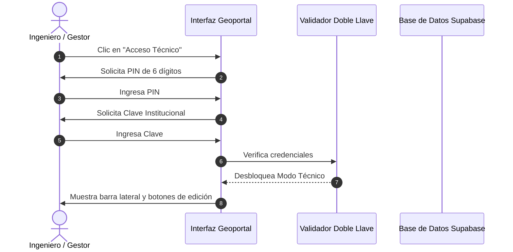

# 🗺️ Plan Maestro y Arquitectura Evolutiva — Geoportal Paneles Lima

Este documento establece la hoja de ruta integral, técnica y de diseño para la evolución del **Geoportal de Publicidad Exterior (EPE) de Lima Metropolitana**. 

Está diseñado bajo una premisa fundamental: **Sincronización Total y Escalabilidad a Futuro** (el sistema debe funcionar de manera automática y fluida tanto con 400 paneles como con 2,000 o 10,000, sin tocar una sola línea de código al incorporar nuevos datos).

---

## 🏛️ 1. Filosofía de Diseño e Identidad Visual

* **Estilo Visual Institucional Limpio:** Se mantiene la estética corporativa y clara actual, con paneles flotantes en vidrio esmerilado (*glassmorphism* suave, fondo blanco translúcido, sombras de alta fidelidad y bordes sutiles).
* **Contador Reactivo Superior:** Se preserva el indicador verde de estado (`400 Paneles`), el cual actualiza sus cifras al instante cuando el usuario aplica filtros.
* **Naturaleza del Mapa Vivo:** El mapa no es estático ni un dibujo rasterizado; cada panel es una entidad vectorial geoespacial viva (WGS84 con coordenadas exactas sin límite de decimales), vinculada a la red vial y a la base de datos Supabase en tiempo real.

---

## 📊 2. Nuevo Sistema de Métricas Viales y Territoriales

Se reemplaza el sistema de gráficos anterior por analítica real, útil para transportistas, fiscalizadores municipales e inversionistas de marketing:

```
┌─────────────────────────────────────────────────────────────────────────────┐
│                       PANEL DE MÉTRICAS TERRITORIALES                       │
├──────────────────────────────┬──────────────────────────────┬───────────────┤
│ 1. RANKING EJES Y VÍAS       │ 2. DENSIDAD POR DISTRITO     │ 3. EMPRESAS   │
│ [Todas] [Ejes/Av.] [Calles]  │ Top 10 Distritos             │ Top 10 Conces.│
│ 1. Av. Javier Prado   (42)   │ 1. Santiago de Surco  (48)   │ 1. BOOMERANG  │
│ 2. Panamericana Sur   (38)   │ 2. San Isidro         (41)   │ 2. NAPSA      │
│ 3. Av. Salaverry      (25)   │ 3. Miraflores         (36)   │ 3. PUNTO VIS. │
│ 4. Jr. Huaraz         (18)   │ 4. La Victoria        (31)   │ 4. CLEAR CH.  │
│ ...                          │ ...                          │ ...           │
└──────────────────────────────┴──────────────────────────────┴───────────────┘
```

### Métrica A: Ranking de Ejes, Avenidas y Calles Viales (Top 10 Interactivo)
* **¿Qué calcula?:** Analiza la columna de dirección y normaliza las vías metropolitanas para determinar la concentración vehicular y publicitaria.
* **Selector Integrado:**
  1. `Todas las Vías`: Ranking general unificado (las 10 vías con más paneles de Lima, ya sean autopistas, avenidas o jirones).
  2. `Ejes y Corredores Metropolitanos`: Filtra estrictamente las vías de alto flujo (Avenidas, Autopistas, Vías Expresas, Panamericana).
  3. `Calles y Jirones`: Muestra el Top 10 exclusivo de vías secundarias locales.
* **Interactividad en el Mapa:** Al hacer clic en cualquier barra del ranking (por ejemplo, *Av. Salaverry*), el mapa automáticamente vuela (`flyTo`) y enfoca los paneles de ese corredor.
* **Sincronización Automática:** Si mañana se agregan 200 paneles en el Excel o desde la web, el ranking se recalcula solo en memoria en 5 milisegundos.

### Métrica B: Densidad por Distrito (Top 10)
* Gráfica horizontal de barras estilizada que clasifica los 10 distritos con mayor concentración de elementos autorizados, permitiendo identificar zonas saturadas versus distritos con alta demanda comercial disponible.

### Métrica C: Concentración por Empresa Concesionaria (Top 10)
* Ranking del mercado publicitario que clasifica a las empresas según su cantidad de soportes vigentes en la ciudad.

> [!NOTE]
> **Sobre la Tipología de Soportes:** En la base de datos existe la columna `tipoEPE` (*Panel monumental unipolar, Paleta, Tótem, etc.*). Para garantizar absoluta fidelidad con el criterio del ingeniero de transportes, esta métrica se mantiene en pausa hasta que se defina la taxonomía oficial definitiva.

---

## 🔐 3. Módulo de "Acceso Técnico" (Administración en Vivo)

Diseñado para operar en campo o en oficina sin la burocracia de crear cuentas de usuario ni confirmaciones de correo:

### A. Mecanismo de Seguridad: "Doble Llave Institucional"
1. **Acceso Discreto:** Botón sobrio en la barra superior con ícono de llave/credencial: **"Acceso Técnico"**.
2. **Paso 1:** Solicita el **PIN de Identificación** (código numérico de 6 dígitos).
3. **Paso 2:** Al validar el PIN, solicita la **Clave Institucional** (palabra clave de seguridad del equipo).
4. **Estado Activo:** Al autenticar, no se usan carteles ruidosos. Aparece en el encabezado un distintivo sutil: *"Sesión Técnica Activa"* y se habilitan los controles de creación y edición.



---

## 📝 4. Registro y Edición de Paneles (Slide-Over Drawer)

Nada de modales toscos ni ventanas emergentes que tapen el mapa. Se implementará un **Panel Lateral Deslizante (Drawer)** desde el borde derecho, integrado suavemente con el diseño.

```
┌─────────────────────────────────────────────────────────┬──────────────────────┐
│                                                         │ 🛠️ NUEVO PANEL       │
│                                                         ├──────────────────────┤
│                                                         │ Código Oficial *     │
│                     MAPA INTERACTIVO                    │ [ 401_NAP          ] │
│                   (Plenamente visible)                  │                      │
│                                                         │ Ubicación *          │
│                      [Punto Marcado]                    │ [📍 Marcar en Mapa ] │
│                             ▲                           │ Lat: -12.06535376    │
│                             │                           │ Lon: -77.03906696    │
│                                                         │                      │
│                                                         │ Dirección / Vía *    │
│                                                         │ [ Av. Salaverry    ] │
│                                                         │                      │
│                                                         │ Empresa *            │
│                                                         │ [ PANELES NAPSA ▼  ] │
│                                                         │                      │
│                                                         │ [ Guardar Panel ]    │
└─────────────────────────────────────────────────────────┴──────────────────────┘
```

### Modos de Asignación de Coordenadas:
1. **Modo Lápiz / Entrada Manual:** El ingeniero escribe o copia directamente las coordenadas desde su informe con **cualquier cantidad de decimales** (la base de datos ya soporta precisión ilimitada).
2. **Modo "📍 Marcar en Mapa":** El cursor se transforma en una mira geodésica. El ingeniero hace clic sobre la calzada y las coordenadas exactas se autocompletan solas en el formulario.

### Campos Requeridos vs. Flexibilidad:
* **Campos Mínimos Obligatorios:** 
  1. `Código` del panel.
  2. `Coordenadas` (Latitud y Longitud).
  3. `Dirección` (Nombre de calle o vía).
  4. `Empresa` concesionaria.
  5. `Distrito`.
* **Campos Secundarios Opcionales:** Los otros 17 campos (materiales, fechas de contrato, FRAP, dimensiones) pueden completarse o dejarse en blanco.
* **Confirmación inteligente al guardar:** Si faltan datos secundarios, el sistema no bloquea al usuario; muestra un aviso de confirmación:
  > *"Hay especificaciones técnicas secundarias pendientes. ¿Deseas guardar los datos básicos ahora y completarlas más adelante?"* `[Continuar y Guardar]` `[Seguir Editando]`

### Sensor Inteligente de Proximidad Vial (Escalable a Futuro):
* Diseñado con arquitectura abierta: calcula la distancia euclidiana/geodésica respecto a cualquier panel vecino.
* Si el punto marcado interseca el radio de protección normativo (hoy 100m, o radios menores cuando el ingeniero defina la matriz técnica por tipo de soporte), emite una advertencia visual de ingeniería para alertar si el punto incumple la distancia mínima entre elementos.

### Edición en Vivo:
* Con el Acceso Técnico activo, al tocar cualquier panel del mapa, en su ficha de detalle aparece el botón **"Editar"**. Al pulsarlo, el panel lateral se abre con la información existente para corregir direcciones, empresas o fechas en 2 clics.

---

## 🖥️ 5. Modo "Sala de Directorio" (Pantalla Completa Kiosk)

* Botón discreto en los controles del mapa (ícono de expandir `⛶`).
* Al activarse, oculta con una transición suave el encabezado superior y los paneles de filtros, dejando el mapa interactivo de borde a borde ocupando el 100% de la pantalla.
* Ideal para proyectores en salas de reuniones o exposiciones a inversionistas.
* Un botón flotante translúcido en la esquina superior permite salir del modo pantalla completa en cualquier instante.

---

## 🚀 6. Fases de Implementación Recomendadas


### Fase 1: Limpieza y Nuevo Dashboard de Métricas Viales
1. Depurar el código de métricas antiguo.
2. Implementar el **Ranking de Ejes y Corredores Viales (Top 10)** con alternador de vías principales vs secundarias y vuelo interactivo.
3. Incorporar los gráficos de **Densidad por Distrito** y **Concentración por Empresa**.
4. Asegurar recálculo automático reactivo sin importar cuántos paneles se añadan a futuro.

### Fase 2: Módulo de Acceso Técnico y Drawer de Edición
1. Implementar el diálogo seguro de **Doble Llave** (PIN de 6 dígitos + Clave institucional).
2. Construir el **Slide-Over Drawer lateral** (panel deslizante que no tape el mapa).
3. Conectar la inserción y edición directa contra Supabase vía API segura.
4. Función de captura *"📍 Marcar en Mapa"*.

### Fase 3: Sensor de Proximidad y Modo Sala de Directorio
1. Implementar la validación matemática de proximidad entre paneles.
2. Botón de **Pantalla Completa Kiosk** para reuniones ejecutivas.
3. Auditoría integral de rendimiento y sincronización general.

